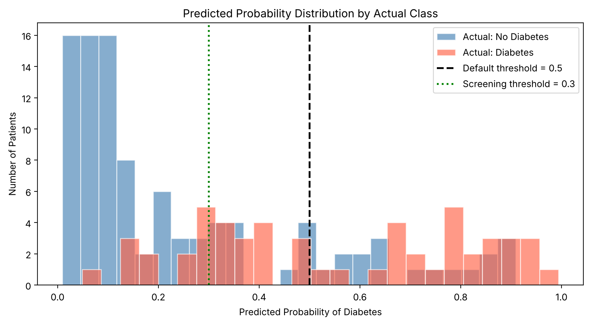
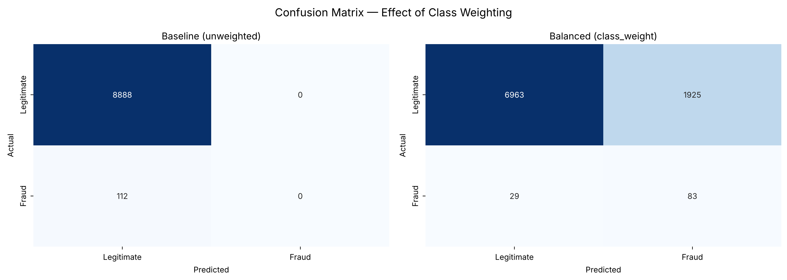
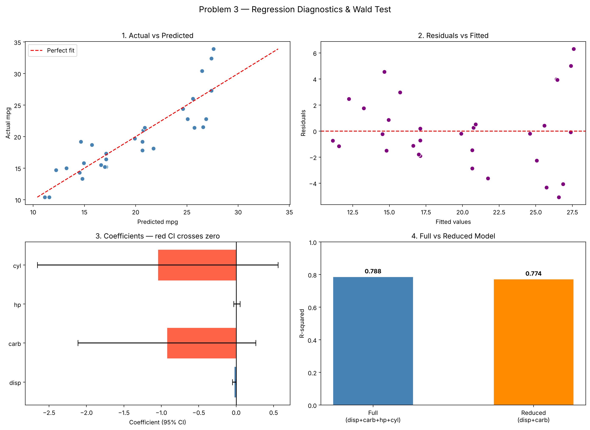

# Logistic Regression for Business Decisions

Three short case studies on one question: **how do you turn a regression model into a decision someone can act on?**

Each notebook follows the same eight steps: business objective, data understanding, cleaning, variable roles, modelling, visuals, business interpretation, conclusion. The focus is less on getting a high score and more on what the numbers mean, where they mislead, and what a manager should do next.

## The three projects

| # | Notebook | Industry | Method | Headline result |
|---|----------|----------|--------|-----------------|
| 1 | [Diabetes risk screening](notebooks/01_diabetes_risk_screening.ipynb) | Healthcare | Logistic regression, 768 patients | AUC 0.81. At the default cut-off the model misses half of the diabetics; at 0.30 it catches 80% |
| 2 | [Card fraud and the accuracy paradox](notebooks/02_fraud_detection_class_imbalance.ipynb) | Banking | Logistic regression with class weights, 30,000 simulated transactions | 98.8% accuracy with zero fraud caught, versus 74% recall after rebalancing |
| 3 | [Dropping predictors with a Wald test](notebooks/03_wald_test_mtcars.ipynb) | Automotive | OLS plus joint Wald test, 32 cars | `hp` and `cyl` can be dropped together (p = 0.41) with almost no loss of fit |

## What I found

**Diabetes screening: the default threshold is the wrong one.**
Glucose and BMI are the strongest predictors, and family history has the largest per-unit effect (though the least precise estimate). At the standard 0.5 cut-off the model catches only 27 of 54 diabetics. Moving the threshold to 0.3 finds 16 more for the cost of 11 extra false alarms, which is an easy trade when a miss means untreated disease and a false alarm means one more blood test.



**Fraud: accuracy was hiding everything.**
With about 1 fraud in 80 transactions, a model that flags nothing scores 98.8% accuracy and catches 0 of 112 frauds. Class weighting lifts recall to 74% (83 of 112), at the cost of 1,925 false alarms and accuracy falling to 78%. A side-investigation also showed the unweighted baseline wasn't just weak but badly fitted: unscaled features broke the `liblinear` solver (AUC 0.51), and scaling alone brings that to 0.84. A good reminder to check more than one metric.



**Wald test: individual p-values can mislead.**
Three of the four predictors in the mtcars model looked insignificant individually, and `hp` even had a nonsensical positive sign thanks to multicollinearity. A joint test confirms `hp` and `cyl` can leave together, giving a simpler model (R² 0.788 → 0.774, lower AIC).



## Data notes

| Project | Data | Source |
|---------|------|--------|
| 1 | Pima Indians Diabetes, 768 rows | Public dataset (NIDDK / UCI), included in `data/` |
| 2 | **Simulated**, 30,000 rows | Generated inside the notebook (seeded) to mimic the layout of the Kaggle credit-card fraud file |
| 3 | `mtcars`, 32 rows | Classic R dataset, embedded in the notebook |

**On the simulated fraud data:** the fraud signal comes from a known formula, so the findings in notebook 2 are effects I planted rather than discoveries about real customers. The notebook compares the model's estimates to the planted values (they match closely), and it can be pointed at the real Kaggle `creditcard.csv` by swapping one cell.

More detail in [`data/README.md`](data/README.md).

## Limitations

- Diabetes thresholds are read off the test set (154 patients). A real deployment would tune them on a separate validation set with actual cost figures.
- The fraud model's precision is about 4%, so it works as a first-stage filter rather than a standalone blocker.
- The fraud data is synthetic, and V1–V28 are anonymous by design.
- mtcars is tiny (n = 32) and used to illustrate a technique, not to draw engineering conclusions.

## Run it yourself

```bash
git clone https://github.com/<your-username>/logistic-regression-business-analytics.git
cd logistic-regression-business-analytics
python -m venv .venv && source .venv/bin/activate   # Windows: .venv\Scripts\activate
pip install -r requirements.txt
jupyter lab notebooks/
```

The notebooks run top to bottom with no extra setup. They were executed with Python 3.12, pandas 3.0, scikit-learn 1.9 and statsmodels 0.15, and the outputs saved in them are from that run.

## Repo layout

```
├── notebooks/          the three analyses, with outputs saved
├── data/               diabetes.csv and data notes
├── reports/figures/    charts exported from the notebooks
├── docs/methodology.md short reference on logistic regression and the Wald test
├── requirements.txt
└── LICENSE
```

## Tools

Python, pandas, NumPy, scikit-learn, statsmodels, matplotlib, seaborn.

## About

Built by **[Your Name]**. [LinkedIn](https://www.linkedin.com/in/your-profile) · [Email](mailto:you@example.com)
